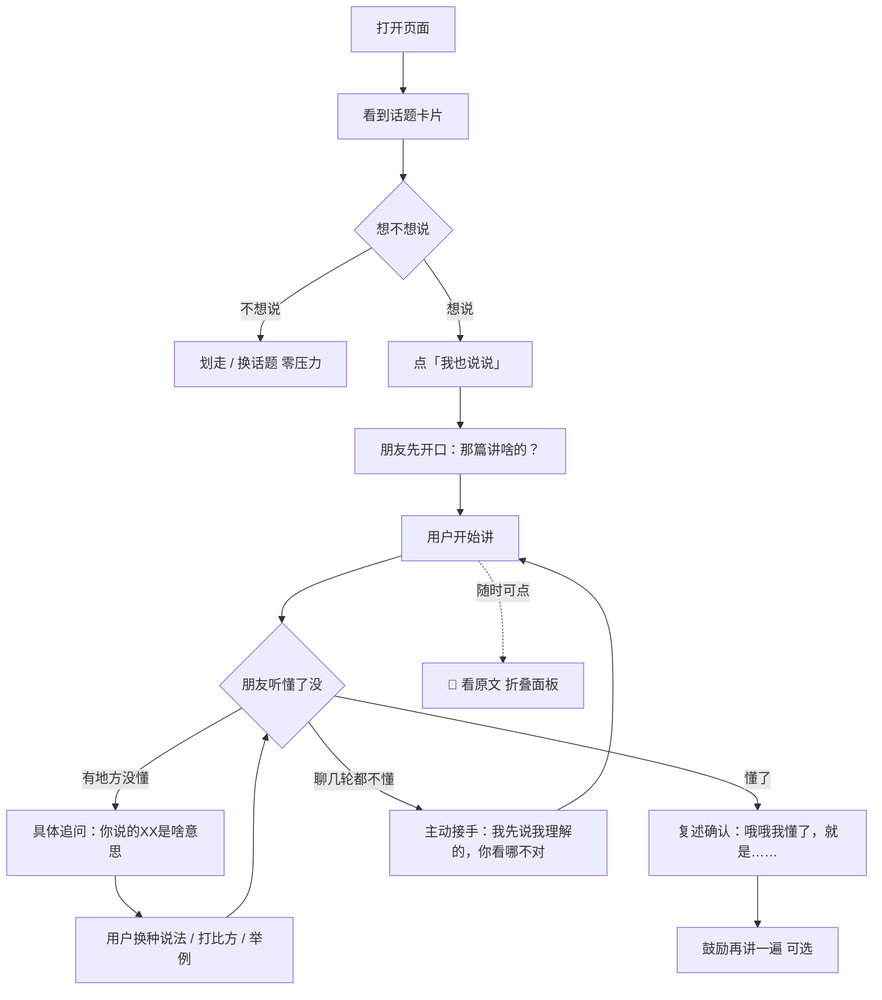

# V0.1 核心流程 · 讲给朋友听

> 单版本 PRD：仅记录 V0.1 的开发任务与落地情况
> 版本状态：✅ 已完成（2026-10-08）

## 版本核心目标

验证一件事：**「把知道的事讲给一个不懂的朋友听」这套机制能不能成立。**

具体是三个假设：
1. 用户愿意开口讲（不会被"要讲话"吓退）
2. AI 的追问能让用户继续说（而不是冷场或让人烦）
3. 用户讲完、AI 说"我懂了"时，用户有"我说清楚了"的成就感

**明确不做**（本期边界）：情景导入式提问、现象热点、小故事、产品名、首屏设计、个性化兴趣、社交元素、留存机制、账号体系。

## 版本用户旅程



## 用户故事

### US-V01-01 浏览话题卡片（UI）

**业务逻辑**：打开页面即看到一张话题卡片，含分类标签、标题、内容正文，底部主按钮「🎤 我也说说」。内容下方有一句安抚文案，强调没有打卡压力。页面底部提供话题切换，可横向切换已上线的话题。

**界面线框图**：

```
┌──────────────────────────────────────┐
│ 讲给朋友听 · 他听懂了，你就讲明白了      │
│                                      │
│ ┌──────────────────────────────────┐ │
│ │ (AI 名词)                        │ │ ← 分类标签（珊瑚色胶囊）
│ │                                  │ │
│ │ 什么是 Agent？                    │ │ ← 标题
│ │                                  │ │
│ │ Agent（智能体）是这两年最火的一个词。│ │
│ │ Claude Code、Codex、Manus 这些…   │ │ ← 内容正文（可长）
│ │                                  │ │
│ │ ┌──────────────────────────────┐ │ │
│ │ │        🎤 我也说说            │ │ │ ← 主按钮（珊瑚色实心）
│ │ └──────────────────────────────┘ │ │
│ │ 不想说也没关系，划走就行 —— 这儿没  │ │ ← 安抚文案
│ │ 有打卡，也没人催你。               │ │
│ └──────────────────────────────────┘ │
│                                      │
│  [什么是 Agent？] [什么是 RAG？] [幻觉] │ ← 话题切换
└──────────────────────────────────────┘
```

**验收标准**：
- [x] 打开页面 1 秒内显示卡片（含标签、标题、正文、按钮）
- [x] 卡片正文支持多段落换行显示
- [x] 点击底部话题标签可切换话题，卡片内容同步更新
- [x] 切换话题时对话状态重置（不会串话题）

### US-V01-02 进入对话 · 朋友先开口（UI）

**业务逻辑**：点击「我也说说」后切换到对话视图。**AI 先说话**（不是等用户开口）——用一句口语化的邀请把话头递出去，降低"我该从哪说起"的启动成本。

**界面线框图**：

```
┌──────────────────────────────────────┐
│ [🙋] 小问                            │
│      不太懂，但很想听你说    [📖 看原文] │ ← 顶部固定
├──────────────────────────────────────┤
│                                      │
│ ┌────────────────────┐               │
│ │ 诶，你刚看的那篇讲  │               │ ← 朋友先开口（左侧白气泡）
│ │ 啥的？说来听听，我  │               │
│ │ 不太懂这个 👀       │               │
│ └────────────────────┘               │
│                                      │
│                  ┌──────────────────┐│
│                  │ 就是一种能自己干活 ││ ← 用户消息（右侧珊瑚气泡）
│                  │ 的AI              ││
│                  └──────────────────┘│
│ ┌────────────────────────────┐       │
│ │ 哦哦我懂了——就是丢个任务给 │       │ ← AI 复述 + 追问
│ │ 它，它自己就能把活干完对吧？│       │
│ │                            │       │
│ │ 那它自己咋知道该先干啥后干  │       │
│ │ 啥呀？                     │       │
│ └────────────────────────────┘       │
│                                      │
├──────────────────────────────────────┤
│ [讲讲你的理解…（可以用输入法的语音说）] ↑ │ ← 底部输入栏
└──────────────────────────────────────┘
```

**验收标准**：
- [x] 点击「我也说说」后进入对话视图，卡片视图隐藏
- [x] 进入后 AI 先发一条开场消息（不等用户）
- [x] 发送消息后输入框清空，AI 回复期间显示"小问正在听…"
- [x] 收到回复后提示消失，自动滚动到最新消息
- [x] 空输入不触发发送

### US-V01-03 讲 + 被追问（核心）

**业务逻辑**：用户用自己的话讲。AI 扮演一个不懂的朋友：

| 行为 | 要求 |
|---|---|
| 有反应 | 随口回应（"哦哦""然后呢"），不冷场 |
| 追问 | **必须具体指出是哪里没懂**，不能笼统说"我不太明白" |
| 会猜 | 说不清时主动猜（"我猜是不是……对吗？"） |
| 不评价 | **禁止**评论用户的表达（"你说得很清楚"这类一句都不能有） |
| 不客服腔 | 禁止"请继续说明""理解您的意思了" |
| 简短 | 每次 1-3 句，像发微信 |

**验收标准**：
- [x] 用户讲得含糊时，AI 的追问能指到具体位置（实测："那它自己咋知道该先干啥后干啥呀？"）
- [x] AI 回复长度控制在 1-3 句（实测通过）
- [x] AI 全程不出现对用户表达的评价性语句（实测通过）
- [x] AI 不出现客服腔用语（实测通过）

### US-V01-04 随时看原文（UI）

**业务逻辑**：用户讲的过程中忘词是常态，不应因此卡住。对话视图右上角提供「📖 看原文」，点击展开原文面板（可滚动），再点收起。

**验收标准**：
- [x] 点击「📖 看原文」展开原文面板，按钮变为「✕ 收起」
- [x] 再点击收起，按钮文案复原
- [x] 切换话题后面板自动收起、按钮文案复原
- [ ] 展开面板时不打断输入焦点（待验证）

### US-V01-05 收尾：听懂确认 + 鼓励再讲一遍

**业务逻辑**：当用户表示讲完了（自然语言，如"差不多就是这样""我说完了"），若 AI 确实听懂了 → **复述确认**（"哦哦我懂了——就是……"）+ **鼓励再讲一遍**（"你要不要再顺一遍？我感觉这次能更清楚"）。

"再讲一遍"是**鼓励不是要求**，用户可跳过——第二遍通常更顺，用户能真切感到自己进步。

**验收标准**：
- [x] 用户说"讲得差不多了"时，AI 复述确认并鼓励再顺一遍（实测通过）
- [x] 鼓励语不构成强制（是邀请语气，不是任务指令）

### US-V01-06 兜底：讲不清时 AI 主动接手

**业务逻辑**：如果聊了几轮 AI 还是没懂，**不能干等着**——主动接过来，把自己的理解说出来让用户纠正：

> "这样吧，我先说说我理解的，你看哪儿不对——……"

角色反转：用户从"我要讲明白"变成"我来纠正你"，压力归零，话自然就多了。

**验收标准**：
- [x] 用户反复说不清时，AI 会主动给出自己的猜测供用户纠正（实测通过）
- [x] 猜测的语气是邀请确认，不是下结论

## 异常/边界约束

| 场景 | 处理 |
|---|---|
| 用户完全不说话 | 不催促、不计时、不提示"快说呀"——用户划走即离开，无任何负担 |
| 请求体编码/格式异常 | 返回 400，服务不崩溃（沿用已验证的防护） |
| 模型接口超时/失败 | 前端显示"[网络出错]"，服务继续可用 |
| 切换话题 | 对话历史清空，AI 人设与参考材料按新话题重建 |
| 用户说的内容与话题无关 | 未做限制（V0.1 观察为主；是否需要拉回话题待 V0.2 判断） |

## 落地差异说明（与原设计的差异）

1. **砍掉网页自带语音输入**。原设计用浏览器 Speech Recognition，实测发现：① iOS Safari 支持不稳定 ② 手机输入法自带语音更好用（用户实际就用这个）。**改为直接用输入法语音，网页不做额外处理**。
2. **砍掉「我说完了」按钮**。原设计用按钮触发收尾，实测发现用户会误触，且**"讲完了"本来就可以直接说出口**（"差不多就是这样"）——更自然，也更符合产品调性。改为自然语言结束。
3. **麦克风按钮一并移除**。交互上"点一下录音、再点一下发送"在手机上易误操作，且与输入法语音重复。
4. **内容仅上 3 个 AI 名词**。原计划小故事/现象热点本期不做（详见总集版本规划）。

## 技术实现

- 模型：腾讯混元 hy3（OpenAI 兼容接口）
- 服务：Python 标准库 HTTP 服务（零第三方依赖），端口 8100
- 核心：`app/chat.py` 的 `build_system_prompt()`——AI 人设与行为规则（产品的心脏）
- 内容：`app/topics.json`（话题可扩展）
- 手机测试：cpolar 公网隧道（HTTPS，便于手机访问）

## 后续说明（2026-10-10 补记，**不改本版历史记录**）

本版定义的界面交互，有一部分已被 V0.3 推翻。**机制没变（讲 → 追问 → 复述确认 → 主动接手），变的是它长在哪儿。**

| 本版设计 | V0.3 改成 | 为什么 |
|---|---|---|
| 卡片视图 → 点「🎤 我也说说」→ 切到对话视图 | **没有"进入对话"这个动作**：对话一直都在，材料是它上面一条可折展的带子 | 把对话装进卡片里，会长成"三个小问，各记各的" |
| 底部话题切换 chips 横向切话题 | 「换个材料」面板（两区：还没讲的 / 小问记住了） | 话题一多，chips 放不下；且讲过的材料该有个家 |
| 切换话题 → **对话历史清空** | **对话不清空**（唯一对话流） | 材料是"她递给你的一张纸"，不是"另一个她" |
| 「📖 看原文」是对话页右上角按钮 | 材料条本身的「展开 / 收起」 | 少一个控件 |

详见 [V0.3-记忆.md](V0.3-记忆.md)、设计稿 `设计/v0.3-记忆/`。
